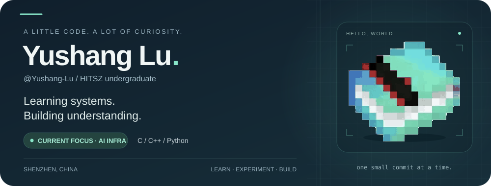

  

**About me**

I'm Yushang Lu, an undergraduate at **Harbin Institute of Technology, Shenzhen**, based in Shenzhen, China. I'm currently learning **AI infrastructure**, with an interest in understanding the systems behind the models.

This is my space for learning in public: code, experiments, coursework, and ideas that become small projects.

**Around this GitHub**

- **AI systems** — learning through [llaisys-26s](https://github.com/Yushang-Lu/llaisys-26s), my fork of the *Let's Learn AI SYStem* project.
- **Challenges & experiments** — [GoldRush_Game](https://github.com/Yushang-Lu/GoldRush_Game), code for the Ubiquant Challenge GoldRush 2.0; and [Team2_model](https://github.com/Yushang-Lu/Team2_model), a lightweight TensorFlow image classifier.
- **Coursework & tools** — [PHYS1006A](https://github.com/Yushang-Lu/PHYS1006A), LaTeX templates and code for physics experiment reports.

**Elsewhere**

[Personal blog](https://yushang-lu.github.io) · [All repositories](https://github.com/Yushang-Lu?tab=repositories) · [Stars & discoveries](https://github.com/Yushang-Lu?tab=stars)

**Tech stack**

<a href="https://github.com/tandpfun/skill-icons">
  <picture>
    <source media="(prefers-color-scheme: dark)" srcset="https://skillicons.dev/icons?i=c%2Ccpp%2Cpy&amp;theme=dark" />
    <source media="(prefers-color-scheme: light)" srcset="https://skillicons.dev/icons?i=c%2Ccpp%2Cpy&amp;theme=light" />
    
  </picture>
</a>

 
 

<picture>
  <source media="(prefers-color-scheme: dark)" srcset="https://raw.githubusercontent.com/Yushang-Lu/Yushang-Lu/output/github-snake-dark.svg" />
  <source media="(prefers-color-scheme: light)" srcset="https://raw.githubusercontent.com/Yushang-Lu/Yushang-Lu/output/github-snake.svg" />
  
</picture>
